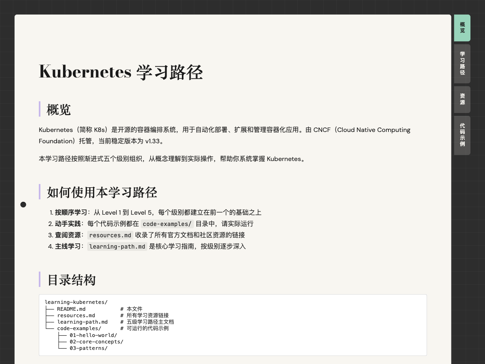

# 🏭 学习工厂（Learning Factory）

[English](README.en.md) | **中文**

> 还在为学习一项新技术不知从何下手吗？还在为四处搜集教程、甄别资源质量、拼凑学习路径而耗掉整晚吗？
>
> 把这些交给**学习工厂**：一句话说出你想学的东西，它会在本地生成一份拿来就能开始的学习包——五级学习路径、参考资源与可运行的代码示例，并自动聚合成一个双击即看的交互式 HTML 页面。

**推荐通过 Agent Skill 使用（零配置）**：skill 装进你的 coding agent（Claude Code / Codex 等）后，协调、研究与写作由宿主 agent 本身完成——不需要配置任何 API Key 与模型参数。原有 Python CLI 已冻结于 0.3.0，仅修致命问题（见[下文](#cli冻结维护)）。

## 📒 它能做什么

- **一句话请求，生成完整中文学习包**：五级渐进式学习路径（概览与动机 → 安装与 Hello World → 核心概念 → 实战模式 → 进阶方向），文档一律简体中文（代码、命令与专有名词保留原文）
- **三路研究**：官方文档、仓库分析、社区内容三路结果交叉印证，宿主支持并行时三路同时进行
- **产物落盘本地**：导览 README、资源汇总、学习路径主文档、可运行的代码示例，全部写入本地目录
- **单文件交互式 HTML**：研究完成自动把学习包聚合成一个自包含 HTML（四 tab 浏览：概览 / 学习路径 / 资源 / 代码示例，资源链接全部可点击），双击离线可看
- **完成定义（DoD）自检**：宿主在最终回复中逐项确认五级标题、四产物、链接来源与 HTML 构建结果

生成的学习包结构示例（以真实产物 learning-kubernetes 为例）：

```
Learning-Factory/learning-kubernetes/
├── README.md            # 概览和使用说明
├── resources.md         # 全部参考链接（按来源分类）
├── learning-path.md     # 五级学习路径主体内容（约 770 行）
├── code-examples/
│   ├── 01-hello-world/       # nginx-pod.yaml 入门示例
│   ├── 02-core-concepts/     # deployment / service / configmap-secret 3 个核心练习
│   └── 03-patterns/          # cronjob / ingress / stateful-app 等 4 个实践模式
└── learning-kubernetes.html  # 单文件交互式页面（研究完成自动生成）
```

本地已实测生成 10 个不同主题的学习包（transformer / docker / kubernetes / pytorch / ai-agent / vllm 等）。以 learning-kubernetes 包为例，点击下面链接即可打开它自动聚合出的单文件交互式页面——四 tab 浏览（概览 / 学习路径 / 资源 / 代码示例）、资源链接可点击、离线可用：

[](https://shoothedrifter.github.io/LearningFactory/examples/learning-kubernetes.html)

**👉 [在线体验：learning-kubernetes 完整交互式页面](https://shoothedrifter.github.io/LearningFactory/examples/learning-kubernetes.html)**

页面源文件在 [examples/learning-kubernetes.html](examples/learning-kubernetes.html)（自包含单文件，下载后双击即可离线查看）。

## 🪛 安装（Agent Skill，零配置）

skill 实体在本仓库 `.agents/skills/learning-factory/`（单一实体，两个宿主共用）。按你的宿主选择：

| 宿主 | 安装方式 |
|------|----------|
| **Claude Code** | 主路径：`/plugin marketplace add Shoothedrifter/LearningFactory` → `/plugin install learning-factory@LearningFactory`。免 marketplace 兜底：clone 本仓库后把 `.agents/skills/learning-factory/` **复制**到 `~/.claude/skills/`（不要整仓 clone 进 skills 目录——嵌套的 SKILL.md 扫不到） |
| **Codex CLI** | 主路径：用 `$skill-installer` 从本仓库 git URL 装入 `~/.agents/skills/`；或手动复制 `.agents/skills/learning-factory/` 到 `~/.agents/skills/`（不推荐 clone 整仓进你的项目——仓库根的 AGENTS.md 会被当作项目指令加载） |
| **其他宿主** | 任何读 `.agents/skills/`（项目级）或 `~/.agents/skills/`（用户级）的 agent 均可直接使用（v1 未逐一测试） |

零配置指**无需配置任何 API Key 与模型参数**——研究、写作与脚本执行全部走宿主自带的模型与工具。宿主首次运行时的沙箱批准（网络访问、临时目录写入）属宿主原生交互，按提示确认即可。

脚本依赖（markdown / pygments）由 skill 脚本头部的 PEP 723 声明描述：装了 [uv](https://docs.astral.sh/uv/) 则自动装依赖直跑；没有 uv 时用 `python3`（3.9+）直接跑，缺依赖时脚本会给出一行安装指引。

## 🔋 使用

装好后直接在宿主对话里说，中英皆可：

```
给我制定一份学习 Docker 的学习计划
Create a learning plan for Kubernetes
```

宿主会按 SKILL.md 的流程执行：三路研究（官方文档 / 仓库 / 社区）→ 交叉印证 → 写四类产物 → 调 `scripts/build_html.py` 聚合单文件 HTML → 按完成定义（DoD）逐项自检并在最终回复里确认。产出的 HTML 双击即可离线打开：四 tab 切换、资源链接全部可点击、代码示例带语法高亮与行号的嵌套文件树。

多轮续作：中途打断或提示「学习包还不完整」时，再说一句「继续完成任务」即可补齐（skill 的写入纪律是先读后写，不破坏已有内容）。

## 📀 CLI（冻结维护）

Python 脚手架 CLI（`learning-factory` 命令，自带多智能体引擎）**冻结于 0.3.0**：保留可用、修致命问题，不再演进——新功能只进 skill 形态。仍想用 CLI 的：

```bash
pipx install learning-factory          # 从 PyPI 安装
```

CLI 需要配置 `LLM_API_KEY` 等环境变量（OpenAI 兼容供应商），详见 [PyPI 页面](https://pypi.org/project/learning-factory/)或仓库 0.3.0 tag 的 README「配置」章节；会话持久化（`--resume`）等 CLI 专有能力同样冻结。CLI 的 HTML 构建器与 skill 脚本同源：`learning-factory-build` 命令行为与 skill 内 `scripts/build_html.py` 一致（含 `--prune` 瘦身）。

## 📂 更多文档

skill 设计（缺口分析 / 双宿主适配 / 分发策略）、架构设计（Agent 协作 / ReAct 循环）、工具系统、与原版 claude_agent_sdk 的对应关系——全部见 **[AGENTS.md](AGENTS.md)**。

## ⌨️ 开发与测试

```bash
pip install -r requirements-dev.txt
pytest    # 246 项，全 mock 无需真实 API Key
```

skill 包守护测试（frontmatter 合规、引用存在、产物名单一事实源）与脚本测试（3.9 兼容、降级行为）同在 `tests/` 下。

## 注意事项

- skill 的仓库研究策略会在系统临时目录做 `git clone --depth 1` 浅克隆，研究完即删，不留在你的工作区
- `Learning-Factory/` 下的 `learning-pytorch/` 等目录是生成的学习产物（已在 `.gitignore` 中，不入库）

## 许可证

[MIT](LICENSE)
